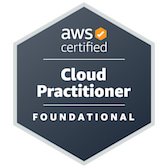
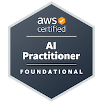
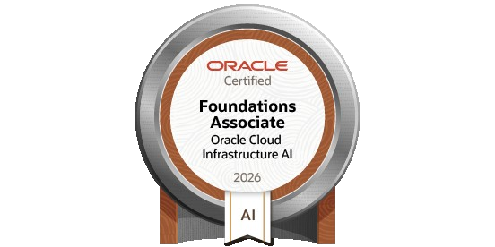
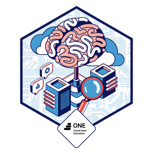
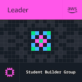
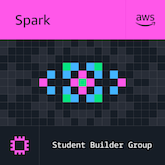
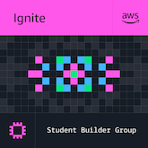
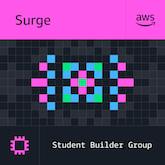

# Hola, soy Arturo!

### Actualmente AWS Student Builder Group Leader @ ITVER

💻 Computer Systems Engineering @ ITVER  
🚀 Interesado en ML, IA Engineering, Cloud y Web Development

## 🔧 Tech Stack
- Python / JavaScript / Typescript / Java
- TensorFlow / PyTorch / NestJs / NexJs / Vite / LangChain / LangGraph / HuggingFace / SpringBoot / FastAPI
- Docker / AWS / OCI

## 🚀 Proyectos destacados
- agroX → Herramienta que permite crear gemelo digital hídrico-fenológico de una parcela agrícola, con comparación de rotaciones de    cultivos y datos abiertos de NASA y otras fuentes públicas
- IRIS → Sistema inteligente de tráfico
- Deriva → App web de colaboración estudiantil para los alumnos del ITVER
- Pegasus Agent → Agente de RAG para Pegasus, proyecto para el challenge de Oracle Next Education

## Badges

  &nbsp;&nbsp;&nbsp;
  &nbsp;&nbsp;&nbsp;
  &nbsp;&nbsp;&nbsp;
  

 

  &nbsp;&nbsp;&nbsp;
  &nbsp;&nbsp;&nbsp;
  &nbsp;&nbsp;&nbsp;
  

## Contactame!
- [Mis links](https://beacons.ai/moco99dev)
